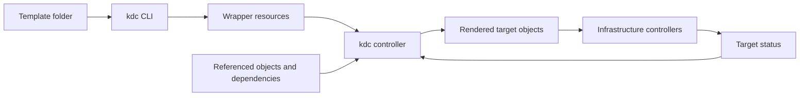

# kdc High Level Design

Status: Proposed

## Purpose

kdc is a Kubernetes Dependency Controller. It wraps Kubernetes objects in a lightweight custom resource, resolves referenced fields, evaluates dependencies, and renders and applies each target object when all prerequisites are satisfied. The target is created or updated in the wrapper's namespace.

The primary use case is managing infrastructure at scale through Kubernetes resources provided by KCC, ACK, ASO, and similar controllers. kdc coordinates their inputs and dependencies; the underlying controllers provision and reconcile the infrastructure.

## Goals and scope

- Wrap arbitrary Kubernetes object kinds without requiring provider-specific target schemas in kdc.
- Accept folders of Helm-like YAML templates through a CLI that makes wrapping transparent to users.
- Apply a target only when every required field reference resolves and every declared dependency is ready.
- Reconcile the target's desired spec at a configurable interval.
- Provide basic templating and advanced manipulation functions for common use cases similar to Terraform functions.
- Expose why a resource is waiting, failed, applied, or ready.

The initial design targets namespaced objects. Cluster-scoped targets require a separate scope and permission decision. Full Helm chart compatibility and full Terraform language compatibility are outside the initial scope.

## Architecture

The CLI packages templates and dependency declarations into wrappers. The controller resolves inputs from the Kubernetes API, evaluates readiness, renders the target, and applies its desired state. Dependency watches provide prompt updates; periodic reconciliation provides a fallback and corrects drift.

## Wrapper resource

The proposed model uses one namespaced wrapper per target object. This keeps reconciliation, status, and deletion policy independent for each infrastructure resource.

| Field | Purpose |
| --- | --- |
| Target | Complete target manifest, including identity, metadata, and desired fields with template expressions. |
| References | Named resource identities shared by templating and dependencies. |
| Lifecycle | Optional target readiness override, dependencies using reference aliases, reconciliation interval, and deletion policy (`abandon`, `delete`, or `prevent-deletion`). |

Object references identify an API version, kind, and name, with an optional namespace. They resolve within the wrapper's namespace by default. Cross-namespace references require admission-controller authorization and controller read permissions. Field selection belongs to templates and dependency predicates, not reference declarations.

Status records the observed wrapper generation, target identity, last successful reconciliation, unresolved inputs, and conditions. Separate conditions describe whether inputs resolved, dependencies are ready, the target was applied, its managed desired fields match the current template render, and the target is ready. The kdc resource reports `Ready=True` when the target is ready and its managed desired fields match the current render. A successful apply alone does not imply readiness.

Proposed API names and field syntax are defined in the [API design](api-design.md).

## CLI workflow

Users maintain ordinary YAML templates and values in a folder. A wrapping command reads the folder, validates supported expressions, and emits wrapper manifests suitable for review, version control, and application through existing Kubernetes workflows.

The CLI should preserve file locations in diagnostics, support multiple YAML documents, and generate stable wrapper identities so repeated wrapping updates existing resources. Ordinary manifests without expressions must also be supported. Dependency declarations should remain close to the target template; their authoring format is an open decision.

Wrapping substitutes local inputs from a values.yaml-style file into the target and packages unresolved reference expressions. There is no wrapper-level values field. Cluster-dependent rendering happens in the controller and always uses declared references. Constants can be hardcoded in the target. A local validation command can check syntax and structure without requiring dependencies to exist.

## References and readiness

A reference identifies another Kubernetes resource, including another wrapper's rendered target. Templates select fields from resolved references, including outputs exposed in status. A missing object or required field leaves the wrapper waiting. Null, false, zero, and an empty string must be distinguished from an absent field; explicit validation determines whether a resolved value is usable.

Dependencies use declared reference aliases and add readiness requirements beyond field availability. Having an output field does not automatically make its source ready. Every declared dependency must satisfy its configured predicate before the target can be applied.

Readiness varies by object kind and provider. The proposed design supports explicit condition or field predicates, with reusable provider profiles where useful. Where supported, readiness checks should account for whether the dependency controller has observed the current generation. An object without a known readiness contract requires an explicit predicate.

Dependencies and references form a graph. The controller indexes these relationships to requeue affected wrappers when sources change. Cycles among known wrappers should produce actionable diagnostics; missing external resources remain waiting dependencies.

## Templating and functions

Runtime templates use declared references and literals in the target. Local values-file inputs are substituted by the CLI before wrapping. Rendering preserves structured types so strings, numbers, booleans, lists, and maps remain valid target data. Missing required inputs and failed expressions block application; the controller never applies a partially rendered object.

The initial function catalog should cover string manipulation, defaults, collection operations, map merging, type conversion, and JSON or YAML encoding and decoding. Function names, semantics, and the template engine remain to be specified. Similarity to Terraform functions describes intended use cases, not compatibility.

Rendering must be deterministic for the same inputs. Templates must not execute arbitrary code, invoke shell commands, or make network requests. Resource limits should bound expression evaluation and output size. Secret values must not appear in logs, events, or wrapper status.

## Reconciliation

For each wrapper, the controller:

1. Validates configuration and target identity.
2. Resolves references and evaluates every dependency predicate.
3. Records waiting conditions if prerequisites are unmet, while continuing target observation.
4. Renders and validates the complete target when required inputs resolve, and compares its managed desired fields with the observed target.
5. Creates or updates the target's managed desired fields in the wrapper's namespace only when all prerequisites are satisfied.
6. Records application results, evaluates target readiness, and reports wrapper readiness when the target is ready and matches the current render.
7. Requeues at the configured interval, with retries for transient errors.

Reconciliation runs on wrapper changes, relevant dependency changes, target changes, and interval expiry. Repeated reconciliations with unchanged inputs should avoid unnecessary writes. kdc manages desired configuration, while the target controller manages status. Field ownership and conflicts must be explicit; kdc should not silently take over an unrelated existing object.

If dependencies become unready after application, keep the existing target and pause further desired spec updates until prerequisites recover. Continue rendering and comparing when required inputs remain available. A target that remains ready and matches the current render keeps its wrapper ready; dependency readiness is a write gate, not an additional wrapper readiness gate. Missing inputs prevent verifying the current render. This avoids deleting infrastructure because a dependency temporarily loses readiness.

## Deletion policies

Each wrapper declares a deletion policy:

| Policy | Behavior when the wrapper is deleted |
| --- | --- |
| `abandon` | Retain the target and stop managing it. |
| `delete` | Request target deletion and wait for its removal before completing wrapper deletion. |
| `prevent-deletion` | Block wrapper deletion and retain the target until the policy is changed. |

Finalizers enforce policies that require coordination. Ownership metadata must not cause automatic target deletion under `abandon` or `prevent-deletion`. The default policy remains to be selected.

Target deletion delegates infrastructure cleanup to its controller and configured lifecycle behavior. Protecting against direct target deletion requires a separate enforcement mechanism; a wrapper finalizer alone does not provide that protection.

## Operations and security

The controller needs permission to read referenced resources and manage allowed target kinds. Arbitrary kind support must remain bounded by RBAC and deployment policy. Namespace isolation and access to Secrets require particular care when one controller serves multiple teams.

For scale, use indexed dependency watches, bounded reconciliation concurrency, and retry backoff. Expose reconciliation errors, waiting reasons, dependency resolution latency, and work queue depth through status, events, logs, and metrics. Errors should identify the affected reference or expression without exposing sensitive values.

## Decisions for detailed design

- CRD naming, schema, template syntax, and dependency authoring format.
- Initial function catalog and readiness profiles for KCC, ACK, and ASO.
- Default reconciliation interval and deletion policy.
- Field ownership, existing target adoption, and changes to target identity.
- Admission-controller policy for cross-namespace references; scope and permissions for cluster-scoped targets.
- Scope of `prevent-deletion`, including direct deletion protection and recovery procedures.

## Validation approach

Validate the design with representative dependency chains across infrastructure resource kinds. Integration coverage should verify missing fields, readiness transitions, changed outputs, desired spec drift, ownership conflicts, controller restarts, cycles, and each deletion policy. Rendering checks should cover type preservation, deterministic output, expression failures, and sensitive value handling.
